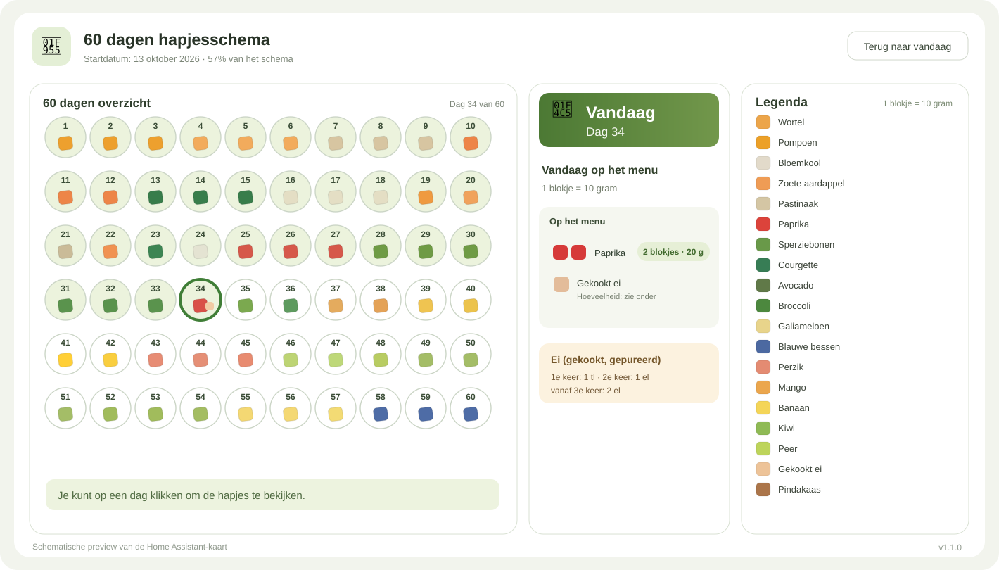

<p align="center">
  
</p>

<h1 align="center">60 Dagen Hapjesschema</h1>

<p align="center">
  Een overzichtelijke, interactieve <strong>Home Assistant-dashboardkaart</strong> voor het 60-dagenhapjesschema.
  Met automatische dagtelling, een dagmenu en een verticale ingrediëntenlegenda.
</p>

<p align="center">
  <a href="https://github.com/Gietje00/60-dagen-hapjesschema-card/releases/latest"></a>
  <a href="https://github.com/Gietje00/60-dagen-hapjesschema-card"></a>
  <a href="https://github.com/Gietje00/60-dagen-hapjesschema-card/blob/main/CHANGELOG.md"></a>
</p>

## Direct installeren

<p align="center">
  <a href="https://my.home-assistant.io/redirect/marketplace_repository/?owner=Gietje00&repository=60-dagen-hapjesschema-card&category=plugin">
    
  </a>
</p>

Gebruik je de oudere HACS-weergave? [Open deze kaart in HACS](https://my.home-assistant.io/redirect/hacs_repository/?owner=Gietje00&repository=60-dagen-hapjesschema-card&category=plugin).

## Zo ziet de kaart eruit



*Voorbeeldweergave met dag 34 geselecteerd. De daadwerkelijke weergave kan per Home Assistant-thema en schermformaat verschillen. Het logo en de preview worden via directe afbeeldingslinks geladen, zodat ze ook op de HACS-detailpagina zichtbaar kunnen zijn.*

## Mogelijkheden

- **60 dagen overzicht:** klik op een dag om de bijbehorende ingrediënten te bekijken.
- **Automatische dagtelling:** start standaard op dag 1; pas de startdatum aan in de grafische kaarteditor.
- **Vandaag op het menu:** aparte kaart met ingrediënten en porties.
- **Blokjes en gramgewicht:** twee blokjes worden ook als twee icoontjes weergegeven; **1 blokje = 10 gram**.
- **Rode paprika:** een zelfgetekend SVG-icoon in plaats van de groene paprika-emoji.
- **Introductie van ei en pindakaas:** aparte hoeveelheidsinstructies volgens het aangeleverde schema.
- **Verticale legenda:** overzicht van de voedingsmiddelen; optioneel te verbergen.
- **Responsive:** werkt op telefoon, tablet en een groot dashboard.
- **Geen extra helpers of sensoren** nodig.

## Installatie via HACS

1. Open **HACS** in Home Assistant.
2. Ga naar **⋮ → Aangepaste repositories**.
3. Voeg `https://github.com/Gietje00/60-dagen-hapjesschema-card` toe als **Dashboard**-repository.
4. Open de kaart in HACS en klik op **Downloaden/Installeren**.
5. Vernieuw de browser of het dashboard.
6. Ga naar **Dashboard bewerken → Kaart toevoegen → 60 Dagen Hapjesschema**.
7. Stel eventueel de **startdatum** in. De kaart berekent de huidige dag automatisch.

## Instellen

De standaardinstellingen vind je in de grafische kaarteditor. Wie liever YAML gebruikt, kan deze kaart handmatig toevoegen:

```yaml
type: custom:hapjesschema-60-dagen-card
start_date: "2026-10-13"
show_today: true
show_legend: true
```

De startdatum in dit voorbeeld is alleen ter illustratie. Bij toevoegen via de kaartkiezer wordt de dag waarop je de kaart toevoegt als startdatum vastgelegd. Bij handmatige YAML zonder `start_date` gebruikt de kaart de huidige datum bij het laden; leg de datum dus vast als je wilt dat de telling automatisch doorloopt.

## Handmatig installeren

Download `dist/60-dagen-hapjesschema-card.js` en plaats het bestand in `/config/www/60-dagen-hapjesschema-card.js`. Voeg daarna bij de Home Assistant-dashboardbronnen `/local/60-dagen-hapjesschema-card.js` toe als **JavaScript-module**.

## Updates

Nieuwe versies worden gepubliceerd onder [GitHub Releases](https://github.com/Gietje00/60-dagen-hapjesschema-card/releases). Als de kaart via HACS is geïnstalleerd, kan HACS nieuwe releases detecteren en een update aanbieden. Zie ook de [changelog](CHANGELOG.md).

## Over het schema

De dagindeling is gebaseerd op een door de gebruiker aangeleverde 60-dagenposter van *Mama Roos Kookt*. Deze communitykaart is geen officiële uitgave van de maker. De illustraties zijn eigen emoji-, CSS- en SVG-ontwerpen.

Het schema is bedoeld als visuele planning en vervangt geen persoonlijk voedingskundig of medisch advies. Bespreek vragen over bijvoeding en allergenen met een deskundige.

---

<p align="center"><sub>Gemaakt voor Home Assistant · 60 Dagen Hapjesschema · versie 1.1.0</sub></p>
